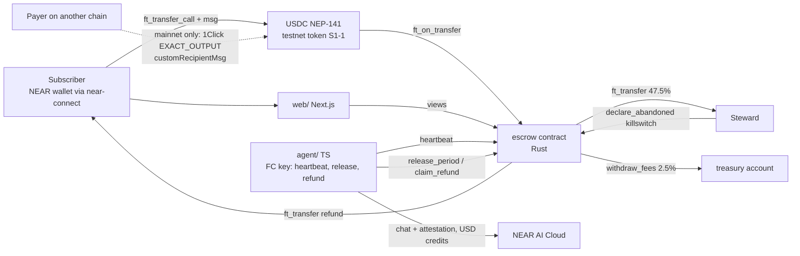
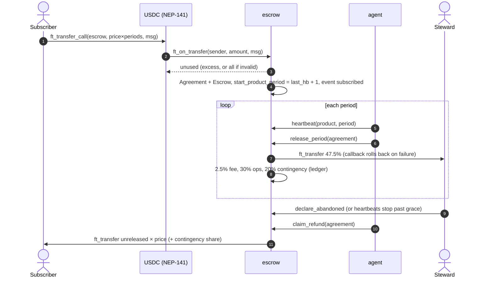
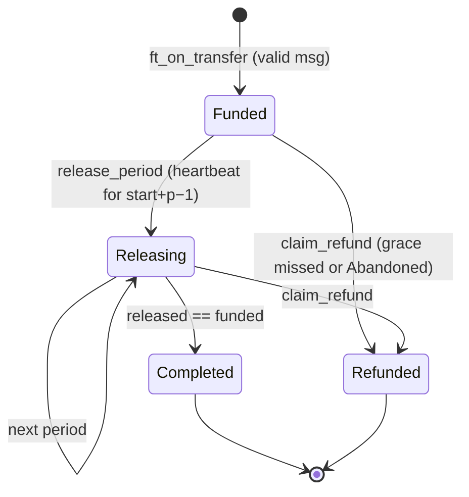
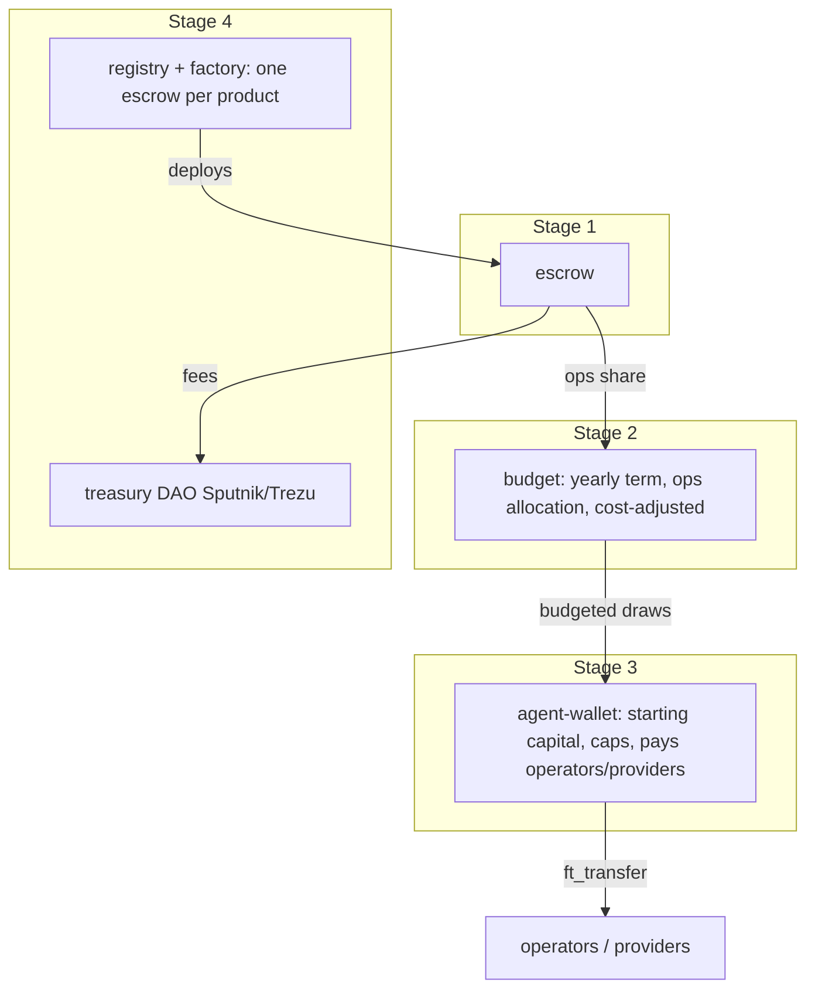

# Architecture

**TL;DR:** Pandem is a set of collaborating NEAR Rust contracts, built in stages. Stage 1 is a single `escrow` contract that holds USDC (NEP-141). It releases one period at a time while heartbeats arrive, and lets anyone trigger a refund when they stop. The TypeScript agent only calls permissionless or heartbeat methods with a function-call key. 1Click is an edge on-ramp on mainnet only. Everything runs on testnet. Interface: TECH-SPEC §3.

## 1. Stage 1 system (testnet demo)

## 2. Subscribe and release

## 3. Agreement lifecycle

## 4. Staged contract set (target)

On-chain: money, agreements, heartbeats (period + status hash) and events. Off-chain: the catalog text, the agent's chat logs and attestation reports, and inference costs (only their hashes go on-chain from stage 3).
