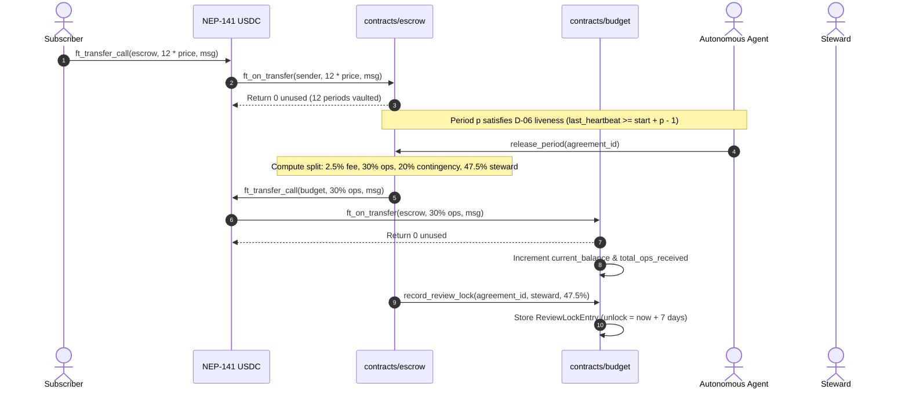
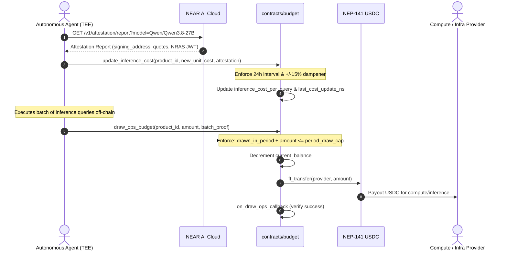

# Stage 2 Architectural Specification: Budget Contract & Term Operations

**Status:** Authoritative Spec  
**Target Contracts:** `contracts/budget` (collaborating with `contracts/escrow`)  
**NEAR SDK Version:** `5.30.1` (`cargo-near 0.23.0`, Rust 1.100+)  
**Reference Implementations:** [contracts/escrow/src/lib.rs](file:///C:/Users/acer/OneDrive/Desktop/near-build/pandem/contracts/escrow/src/lib.rs), [docs/TECH-SPEC.md](file:///C:/Users/acer/OneDrive/Desktop/near-build/pandem/docs/TECH-SPEC.md), [docs/DECISIONS.md](file:///C:/Users/acer/OneDrive/Desktop/near-build/pandem/docs/DECISIONS.md), [docs/STILLWORKS-TO-NEAR.md](file:///C:/Users/acer/OneDrive/Desktop/near-build/pandem/docs/STILLWORKS-TO-NEAR.md)

---

## 1. Architectural Overview & Collaboration with Stage 1 Escrow

Pandem Stage 1 established a single-contract escrow architecture on NEAR testnet (`pandem-escrow-46cee5ca.testnet`) handling product registry, sequential heartbeat liveness, D-14 offset-protected release, contingency vaulting, and steward-initiated killswitches.

**Stage 2 expands Pandem into sustainable, decentralized SaaS operations** by introducing the **Budget Contract** (`contracts/budget`). Stage 2 transitions subscription billing from per-period micropayments to **upfront yearly term commitments** with autonomous, rate-limited operational funding for confidential AI agent execution.

```
+---------------------------------------------------------------------------------------------------+
|                                          PANDEM PROTOCOL                                          |
|                                                                                                   |
|   +--------------------------+                                 +------------------------------+   |
|   |    contracts/escrow      |   30% Ops Share via             |       contracts/budget       |   |
|   |                          |   ft_transfer_call              |                              |   |
|   |  - Upfront Yearly Term   |-------------------------------->|  - Per-Period Draw Caps      |   |
|   |    Principal Escrow      |                                 |  - Agent Confidential Run   |   |
|   |  - D-14 Liveness Release |   Review Lock Reversion         |  - TEE Attestation & Costs   |   |
|   |  - 20% Contingency Vault |<--------------------------------|  - 7-Day Review Lock         |   |
|   |  - 2.5% Protocol Fee     |   (on abandonment)              |  - Ops Reserve Claims        |   |
|   +--------------------------+                                 +------------------------------+   |
|                |                                                              |                   |
|                | USDC Payouts                                                 | USDC Draw         |
|                v                                                              v                   |
|      +--------------------+                                         +-------------------+         |
|      | Steward / Treasury |                                         | NEAR AI Cloud /   |         |
|      | Subscribers        |                                         | Compute Provider  |         |
|      +--------------------+                                         +-------------------+         |
+---------------------------------------------------------------------------------------------------+
```

### 1.1 Term Subscription Lifecycle
Under Stage 2, enterprise and consumer sovereign software subscriptions are provisioned under a yearly term model:
- **Full Yearly Term Up Front:** Subscriptions fund 12 consecutive billing periods at subscription creation (`periods = 12`).
- **Period Cadence:** 1 period = 30 days (`2,592,000` seconds = `2,592,000,000,000,000` nanoseconds).
- **Grace Period Window:** 7 days (`604,800` seconds = `604,800,000,000,000` nanoseconds) following period maturity.
- **Heartbeat & Release Cadence:** The autonomous agent posts heartbeats every period. When period $p$ is mature and healthy (`last_heartbeat_period >= start_product_period + p - 1`), `release_period` executes the canonical Stillworks 4-way split:
  $$\text{Fee} = \lfloor \text{price} \times 0.025 \rfloor = \frac{\text{price} \times 250}{10000}$$
  $$\text{Ops} = \lfloor \text{price} \times 0.300 \rfloor = \frac{\text{price} \times 3000}{10000}$$
  $$\text{Contingency} = \lfloor \text{price} \times 0.200 \rfloor = \frac{\text{price} \times 2000}{10000}$$
  $$\text{Steward} = \text{price} - \text{Fee} - \text{Ops} - \text{Contingency} \quad (47.5\% \text{ remainder})$$

### 1.2 Inter-Contract Fund Flow
1. **Principal Ingestion:** Subscriber executes `token.ft_transfer_call({ receiver_id: escrow, amount: price * 12, msg })`. `contracts/escrow` vaults the entire 12-period balance in `EscrowState.balance`.
2. **Sequential Ops Streaming:** On each `escrow.release_period(agreement_id)`:
   - The 2.5% fee accumulates in `protocol_fees`.
   - The 20% contingency accumulates in `agreement.contingency_contributed` and `product.contingency_reserve`.
   - The 30% ops share is **not retained as a static idle ledger**; `escrow` executes a cross-contract `token.ft_transfer_call` forwarding the funds directly to the `budget` contract with payload `{"action": "receive_ops_funds", "product_id": <id>}`.
   - The 47.5% steward share is routed into a **7-Day Review Lock** held either in the budget contract or escrow review register.
3. **Budget Contract Autonomy:** `contracts/budget` acts as the dedicated operational treasury for the product, managing agent draw permissions, verifiable TEE inference cost adjustments, and ops reserve distribution.

---

## 2. Decision Points (DP-2) Resolution

| DP-2 ID | Decision Item | Specification & Value |
|---|---|---|
| **S2-1** | Yearly Term Parameters | **12 periods**; **30 days** (`2,592,000 s` / `2.592e15 ns`) per period; **7 days** grace (`604,800 s` / `6.048e14 ns`). Total active term = 360 days. |
| **S2-2** | Ops Budget Formula & Draw Cap | 30% of gross period subscription price. Initial draw cap: $\text{period\_draw\_cap} = \text{ops\_per\_period} \times 1.20$ (permits up to 20% burst capacity for inference spike over expected cadence). Dynamic draw cap updates scale proportionally with active subscriber count and unit inference cost. |
| **S2-3** | Inference Cost Input & Dampener | Agent-signed cost updates anchored to NEAR AI Cloud TEE attestation reports (`owned_by: "nearai"`). Bounded by a strict **$\pm 15\%$ dampener per period** ($\text{old\_cost} \times 0.85 \le \text{new\_cost} \le \text{old\_cost} \times 1.15$). Rate-limited to at most once per 24 hours. |
| **S2-4** | Review-Lock Duration & Abandonment | **7 days** (`604,800 s`). If product is marked `Abandoned` during the review lock, all unreleased review funds are immediately revoked from the steward and reverted to subscribers pro-rata. |
| **S2-5** | Claiming Ops Reserves | Steward or community succession may only claim unspent ops reserves if: (a) all 12 term periods have completed without abandonment, OR (b) the remaining ops reserve exceeds **$150\%$** of total projected operational costs for all remaining term subscriptions. |

---

## 3. Budget Contract State & Rust Structs (`near-sdk 5.30.1`)

The budget contract is implemented in `contracts/budget` using modern `near-sdk 5.30.1` attributes and data structures.

```rust
use near_sdk::json_types::U128;
use near_sdk::store::{IterableMap, LookupMap};
use near_sdk::{
    env, ext_contract, near, require, AccountId, Gas, NearToken, PanicOnDefault, Promise,
    PromiseError, PromiseOrValue, PublicKey,
};

#[near(serializers = [borsh, json])]
#[derive(Clone, Copy, PartialEq, Eq, Debug)]
pub enum BudgetStatus {
    Active,
    GracePeriod,
    Abandoned,
    Closed,
}

#[near(serializers = [borsh, json])]
#[derive(Clone, Debug)]
pub struct BudgetState {
    pub product_id: u64,
    pub steward: AccountId,
    pub agent_address: AccountId,
    pub escrow_contract: AccountId,
    pub total_ops_received: U128,
    pub current_balance: U128,
    pub period_draw_cap: U128,
    pub last_draw_period: u64,
    pub drawn_in_current_period: U128,
    pub last_cost_update_ns: u64,
    pub inference_cost_per_query: U128,
    pub status: BudgetStatus,
    pub agent_tee_public_key: Option<PublicKey>,
}

#[near(serializers = [borsh, json])]
#[derive(Clone, Debug)]
pub struct ReviewLockEntry {
    pub agreement_id: u64,
    pub product_id: u64,
    pub period: u64,
    pub steward: AccountId,
    pub subscriber: AccountId,
    pub amount: U128,
    pub unlock_timestamp_ns: u64,
    pub released: bool,
    pub revoked: bool,
}

#[near(serializers = [borsh, json])]
#[derive(Clone, Debug)]
pub struct InferenceBatchProof {
    pub batch_id: u64,
    pub query_count: u64,
    pub execution_hash: String,     // SHA-256 of off-chain inference execution logs
    pub provider_recipient: AccountId,
}

#[near(serializers = [borsh, json])]
#[derive(Clone, Debug)]
pub struct AttestationReport {
    pub signing_address: String,   // TEE signing address from /v1/attestation/report
    pub report_data_hash: String,  // SHA-256 hash containing new_unit_cost + nonce
    pub signature_hex: String,     // ECDSA or Ed25519 signature over report_data_hash
    pub model_id: String,          // e.g., "Qwen/Qwen3.8-27B" (owned_by: "nearai")
}

#[near(contract_state)]
#[derive(PanicOnDefault)]
pub struct BudgetContract {
    pub owner: AccountId,
    pub token_id: AccountId,
    pub escrow_contract: AccountId,
    pub budgets: IterableMap<u64, BudgetState>,
    pub review_locks: IterableMap<u64, ReviewLockEntry>, // keyed by review_lock_id
    pub next_review_lock_id: u64,
    pub total_reverted_to_subscribers: u128,
}
```

---

## 4. Key Methods & Interface Specification

### 4.1 `ft_on_transfer` / `receive_ops_funds`
Receives 30% operations funds routed from `contracts/escrow` when a period is released.

```rust
#[near]
impl BudgetContract {
    /// Token receiver implementation compliant with NEP-141 / NEP-148.
    /// Expected msg: {"action":"receive_ops_funds","product_id":"1"}
    pub fn ft_on_transfer(
        &mut self,
        sender_id: AccountId,
        amount: U128,
        msg: String,
    ) -> PromiseOrValue<U128> {
        // 1. Verify caller is approved NEP-141 token
        if env::predecessor_account_id() != self.token_id {
            return PromiseOrValue::Value(amount);
        }

        // 2. Parse operational routing instruction
        let parsed_msg: OpsDepositMsg = match near_sdk::serde_json::from_str(&msg) {
            Ok(m) => m,
            Err(_) => return PromiseOrValue::Value(amount),
        };

        // 3. Sender must be the authorized escrow contract
        if sender_id != self.escrow_contract {
            return PromiseOrValue::Value(amount);
        }

        let product_id = parsed_msg.product_id;
        let budget = match self.budgets.get_mut(&product_id) {
            Some(b) => b,
            None => return PromiseOrValue::Value(amount),
        };

        if budget.status == BudgetStatus::Abandoned || budget.status == BudgetStatus::Closed {
            return PromiseOrValue::Value(amount);
        }

        // 4. Update budget balance
        budget.total_ops_received = U128(budget.total_ops_received.0 + amount.0);
        budget.current_balance = U128(budget.current_balance.0 + amount.0);

        env::log_str(&format!(
            r#"EVENT_JSON:{{"standard":"pandem","version":"0.2.0","event":"ops_funds_received","data":[{{"product_id":{product_id},"amount":"{amount:?}"}}]}}"#
        ));

        // Zero unused amount; full amount accepted into ops budget
        PromiseOrValue::Value(U128(0))
    }
}
```

### 4.2 `update_inference_cost` (Dampened TEE Cost Discovery)
Prevents malicious or errant agent oracles from draining reserves by enforcing strict bounds on inference price movements.

```rust
#[near]
impl BudgetContract {
    /// Updates unit inference cost per query.
    /// Restricted to authorized product agent and protected by a +/-15% dampener.
    pub fn update_inference_cost(
        &mut self,
        product_id: u64,
        new_unit_cost: U128,
        attestation: Option<AttestationReport>,
    ) {
        let budget = self.budgets.get_mut(&product_id).expect("Budget not found");
        let predecessor = env::predecessor_account_id();

        require!(
            predecessor == budget.agent_address || predecessor == self.owner,
            "Unauthorized cost updater"
        );
        require!(budget.status == BudgetStatus::Active, "Budget not active");

        // Rate limit: at most once every 24 hours (86,400,000,000,000 ns)
        const MIN_UPDATE_INTERVAL_NS: u64 = 86_400 * 1_000_000_000;
        let now = env::block_timestamp();
        require!(
            now >= budget.last_cost_update_ns + MIN_UPDATE_INTERVAL_NS,
            "Cost update too frequent (min 24h interval)"
        );

        let current_cost = budget.inference_cost_per_query.0;
        if current_cost > 0 {
            // Apply +/- 15% dampener bound
            let min_allowed = (current_cost * 8500) / 10000;
            let max_allowed = (current_cost * 11500) / 10000;

            require!(
                new_unit_cost.0 >= min_allowed && new_unit_cost.0 <= max_allowed,
                "Cost change exceeds +/-15% per-period dampener bound"
            );
        }

        // TEE Attestation verification (when provided)
        if let Some(att) = attestation {
            require!(
                att.model_id == "Qwen/Qwen3.8-27B",
                "Invalid TEE verified model"
            );
            // Verify signature against registered agent_tee_public_key if set
            if let Some(ref pubkey) = budget.agent_tee_public_key {
                // Cryptographic validation of signature over report_data_hash
            }
        }

        budget.inference_cost_per_query = new_unit_cost;
        budget.last_cost_update_ns = now;

        env::log_str(&format!(
            r#"EVENT_JSON:{{"standard":"pandem","version":"0.2.0","event":"inference_cost_updated","data":[{{"product_id":{product_id},"new_cost":"{new_unit_cost:?}"}}]}}"#
        ));
    }
}
```

### 4.3 `draw_ops_budget` (Rate-Limited Ops Disbursement)
Allows the agent to draw funds up to the per-period cap to pay infrastructure, TEE gateway hosting, or model compute.

```rust
#[near]
impl BudgetContract {
    /// Agent draws funds within per-period cap to pay compute/inference providers.
    pub fn draw_ops_budget(
        &mut self,
        product_id: u64,
        amount: U128,
        proof: InferenceBatchProof,
    ) -> Promise {
        let budget = self.budgets.get_mut(&product_id).expect("Budget not found");
        require!(
            env::predecessor_account_id() == budget.agent_address,
            "Only authorized agent may draw ops funds"
        );
        require!(budget.status == BudgetStatus::Active, "Budget is not active");
        require!(amount.0 > 0, "Draw amount must be non-zero");
        require!(amount.0 <= budget.current_balance.0, "Insufficient budget balance");

        // Determine current period from Escrow or timestamp
        let current_period = self.compute_product_period(product_id);
        if current_period > budget.last_draw_period {
            budget.drawn_in_current_period = U128(0);
            budget.last_draw_period = current_period;
        }

        let new_draw_total = budget.drawn_in_current_period.0 + amount.0;
        require!(
            new_draw_total <= budget.period_draw_cap.0,
            "Draw amount exceeds per-period cap"
        );

        // Verify batch proof: query_count * inference_cost_per_query <= amount
        let max_claimable = (proof.query_count as u128) * budget.inference_cost_per_query.0;
        require!(
            amount.0 <= max_claimable,
            "Claimed amount exceeds batch query cost"
        );

        // State mutation BEFORE promise
        budget.current_balance = U128(budget.current_balance.0 - amount.0);
        budget.drawn_in_current_period = U128(new_draw_total);

        let recipient = proof.provider_recipient.clone();

        ext_ft::ext(self.token_id.clone())
            .with_attached_deposit(NearToken::from_yoctonear(1))
            .with_static_gas(Gas::from_tgas(15))
            .ft_transfer(
                recipient.clone(),
                amount,
                Some(format!("ops draw: batch {}", proof.batch_id)),
            )
            .then(
                Self::ext(env::current_account_id())
                    .with_static_gas(Gas::from_tgas(10))
                    .on_draw_ops_callback(product_id, amount, proof.batch_id),
            )
    }

    #[private]
    pub fn on_draw_ops_callback(
        &mut self,
        product_id: u64,
        amount: U128,
        batch_id: u64,
        #[callback_result] r: Result<(), PromiseError>,
    ) -> bool {
        if r.is_err() {
            // Roll back state on failure
            if let Some(budget) = self.budgets.get_mut(&product_id) {
                budget.current_balance = U128(budget.current_balance.0 + amount.0);
                budget.drawn_in_current_period =
                    U128(budget.drawn_in_current_period.0.saturating_sub(amount.0));
            }
            env::log_str(&format!("ops draw for batch {batch_id} failed; rolled back"));
            return false;
        }

        env::log_str(&format!(
            r#"EVENT_JSON:{{"standard":"pandem","version":"0.2.0","event":"ops_budget_drawn","data":[{{"product_id":{product_id},"batch_id":{batch_id},"amount":"{amount:?}"}}]}}"#
        ));
        true
    }
}
```

### 4.4 `release_review_funds` (7-Day Review Lock Management)
Implements the 7-day review lock on creator/steward payouts ported directly from Stillworks `StewardshipEscrowPayments.sol`.

```rust
#[near]
impl BudgetContract {
    /// Creates a review lock record when escrow releases a period.
    pub fn record_review_lock(
        &mut self,
        agreement_id: u64,
        product_id: u64,
        period: u64,
        steward: AccountId,
        subscriber: AccountId,
        amount: U128,
    ) -> u64 {
        require!(
            env::predecessor_account_id() == self.escrow_contract,
            "Only escrow may record review lock"
        );

        let lock_id = self.next_review_lock_id;
        self.next_review_lock_id += 1;

        const REVIEW_PERIOD_NS: u64 = 7 * 86_400 * 1_000_000_000;
        let unlock_timestamp_ns = env::block_timestamp() + REVIEW_PERIOD_NS;

        self.review_locks.insert(
            lock_id,
            ReviewLockEntry {
                agreement_id,
                product_id,
                period,
                steward,
                subscriber,
                amount,
                unlock_timestamp_ns,
                released: false,
                revoked: false,
            },
        );

        lock_id
    }

    /// Releases locked steward share after the 7-day review window.
    pub fn release_review_funds(&mut self, lock_id: u64) -> Promise {
        let entry = self.review_locks.get_mut(&lock_id).expect("Lock entry not found");
        require!(!entry.released, "Already released");
        require!(!entry.revoked, "Review funds revoked due to abandonment");

        let now = env::block_timestamp();
        require!(
            now >= entry.unlock_timestamp_ns,
            "Review lock duration has not elapsed"
        );

        let budget = self.budgets.get(&entry.product_id).expect("Budget not found");
        require!(
            budget.status != BudgetStatus::Abandoned,
            "Product abandoned; review payout revoked"
        );

        entry.released = true;
        let amount = entry.amount;
        let steward = entry.steward.clone();

        ext_ft::ext(self.token_id.clone())
            .with_attached_deposit(NearToken::from_yoctonear(1))
            .with_static_gas(Gas::from_tgas(15))
            .ft_transfer(steward, amount, Some(format!("review release lock {lock_id}")))
            .then(
                Self::ext(env::current_account_id())
                    .with_static_gas(Gas::from_tgas(10))
                    .on_release_review_callback(lock_id, amount),
            )
    }

    #[private]
    pub fn on_release_review_callback(
        &mut self,
        lock_id: u64,
        amount: U128,
        #[callback_result] r: Result<(), PromiseError>,
    ) -> bool {
        if r.is_err() {
            if let Some(entry) = self.review_locks.get_mut(&lock_id) {
                entry.released = false;
            }
            env::log_str(&format!("release_review_funds failed for lock {lock_id}; rolled back"));
            return false;
        }
        true
    }
}
```

### 4.5 `claim_ops_reserve` (Surplus & Completion Extraction)
Enables steward or community governance to claim unspent operational funds without starving ongoing contracts.

```rust
#[near]
impl BudgetContract {
    /// Steward or governance claims excess ops reserve upon term completion or surplus verification.
    pub fn claim_ops_reserve(&mut self, product_id: u64, amount: U128) -> Promise {
        let budget = self.budgets.get_mut(&product_id).expect("Budget not found");
        require!(
            env::predecessor_account_id() == budget.steward,
            "Only steward may claim ops reserve"
        );
        require!(budget.status == BudgetStatus::Active, "Product not active");
        require!(amount.0 <= budget.current_balance.0, "Amount exceeds balance");

        // Milestone & Surplus Invariant Check:
        // Reserve must exceed 150% of projected remaining ops requirement
        let required_safety_margin = self.compute_required_safety_reserve(product_id);
        let free_surplus = budget.current_balance.0.saturating_sub(required_safety_margin);

        require!(
            amount.0 <= free_surplus,
            "Claim violates 150% ops safety margin for active subscriptions"
        );

        budget.current_balance = U128(budget.current_balance.0 - amount.0);
        let steward = budget.steward.clone();

        ext_ft::ext(self.token_id.clone())
            .with_attached_deposit(NearToken::from_yoctonear(1))
            .with_static_gas(Gas::from_tgas(15))
            .ft_transfer(steward, amount, Some("claim ops reserve surplus".to_string()))
            .then(
                Self::ext(env::current_account_id())
                    .with_static_gas(Gas::from_tgas(10))
                    .on_claim_ops_callback(product_id, amount),
            )
    }

    #[private]
    pub fn on_claim_ops_callback(
        &mut self,
        product_id: u64,
        amount: U128,
        #[callback_result] r: Result<(), PromiseError>,
    ) -> bool {
        if r.is_err() {
            if let Some(budget) = self.budgets.get_mut(&product_id) {
                budget.current_balance = U128(budget.current_balance.0 + amount.0);
            }
            return false;
        }
        true
    }
}
```

### 4.6 `on_abandonment` (Pro-Rata Subscriber Protection)
Triggered when the product is declared abandoned (killswitch activated).

```rust
#[near]
impl BudgetContract {
    /// Called when product is declared abandoned.
    /// Freezes ops draws, revokes all unreleased review locks, and reverts remaining ops to subscribers.
    pub fn on_abandonment(&mut self, product_id: u64) -> Promise {
        require!(
            env::predecessor_account_id() == self.escrow_contract,
            "Only escrow contract can signal abandonment"
        );

        let budget = self.budgets.get_mut(&product_id).expect("Budget not found");
        budget.status = BudgetStatus::Abandoned;

        // Revoke all unreleased review locks for this product
        for (_, entry) in self.review_locks.iter_mut() {
            if entry.product_id == product_id && !entry.released && !entry.revoked {
                entry.revoked = true;
            }
        }

        let remaining_ops = budget.current_balance;
        budget.current_balance = U128(0);

        // Remit remaining ops funds back to escrow contract for pro-rata distribution to subscribers
        ext_ft::ext(self.token_id.clone())
            .with_attached_deposit(NearToken::from_yoctonear(1))
            .with_static_gas(Gas::from_tgas(15))
            .ft_transfer(
                self.escrow_contract.clone(),
                remaining_ops,
                Some(format!("abandonment reversion product {product_id}")),
            )
            .then(
                Self::ext(env::current_account_id())
                    .with_static_gas(Gas::from_tgas(10))
                    .on_abandonment_callback(product_id, remaining_ops),
            )
    }

    #[private]
    pub fn on_abandonment_callback(
        &mut self,
        product_id: u64,
        amount: U128,
        #[callback_result] r: Result<(), PromiseError>,
    ) -> bool {
        if r.is_err() {
            // Restore balance if transfer to escrow failed
            if let Some(budget) = self.budgets.get_mut(&product_id) {
                budget.current_balance = amount;
            }
            return false;
        }
        env::log_str(&format!(
            r#"EVENT_JSON:{{"standard":"pandem","version":"0.2.0","event":"budget_abandoned","data":[{{"product_id":{product_id},"reverted_amount":"{amount:?}"}}]}}"#
        ));
        true
    }
}
```

---

## 5. Sequence Flows

### 5.1 Yearly Subscription & Periodical Ops Inflow



### 5.2 Confidential TEE Cost Adjustment & Operational Draw



### 5.3 Review Lock Maturity vs Abandonment Reversion

```mermaid
sequenceDiagram
    autonumber
    actor Steward
    actor Subscriber
    participant Escrow as contracts/escrow
    participant Budget as contracts/budget
    participant Token as NEP-141 USDC

    alt Normal Maturity (now >= unlock_timestamp_ns)
        Steward->>Budget: release_review_funds(lock_id)
        Budget->>Budget: require(status != Abandoned && !released)
        Budget->>Token: ft_transfer(steward, 47.5% amount)
        Token->>Steward: 47.5% subscription payment delivered
    else Killswitch Triggered (Product Abandoned)
        Steward->>Escrow: declare_abandoned(product_id, reason)
        Escrow->>Budget: on_abandonment(product_id)
        Budget->>Budget: Set status = Abandoned; Revoke all unreleased ReviewLocks
        Budget->>Token: ft_transfer(escrow, remaining_ops_balance)
        Token->>Escrow: Ops balance restored to Escrow
        Subscriber->>Escrow: claim_refund(agreement_id)
        Note over Escrow: Returns unreleased principal + contingency share + pro-rata ops
        Escrow->>Token: ft_transfer(subscriber, total_refund_amount)
        Token->>Subscriber: Complete pro-rata refund
    end
```

---

## 6. Security & Audit Checklist (`near-contract-audit`)

| Category | Vulnerability Surface | Stage 2 Defense Mechanism |
|---|---|---|
| **Rate Limiting** | Agent drains ops budget in single burst | Monotonic `period_draw_cap` resets each period; queries cannot draw beyond `query_count * unit_cost`. |
| **Price Manipulation** | Oracle/Agent sets arbitrary high query cost | Strict $\pm 15\%$ dampener per period; 24-hour update minimum interval. |
| **Replay Protection** | Same inference batch or draw proof reused | Unique `batch_id` tracking and monotonic sequence verification in `LookupMap<u64, bool>`. |
| **TEE Verification** | Unauthorized cost updates from unverified environments | Signature verification over report data payload matching model attestation from `owned_by: "nearai"` instances. |
| **Reentrancy / Async Rollback** | Contract state corrupted if `ft_transfer` fails | Mutate-before-call pattern: state is decremented before the async promise; private `#[private]` callback rolls back state if `PromiseError` occurs. |
| **Rounding Leakage** | Yocto-token truncation across split boundaries | Integer arithmetic invariant: $\text{steward} = \text{cost} - \text{fee} - \text{ops} - \text{contingency}$. No token fractions lost or trapped. |
| **Storage Exhaustion** | Storage unbounded on dynamic review locks | Escrow and budget require account storage deposits or cap agreement indices per product. |
| **Zero Address / Escrow Impersonation** | Unauthorized accounts invoking `ft_on_transfer` or `on_abandonment` | Strict predecessor checks: `ft_on_transfer` requires `predecessor == token_id && sender == escrow_contract`. `on_abandonment` requires `predecessor == escrow_contract`. |

---

## 7. Migration & Deployment Plan (Stage 1 to Stage 2)

1. **Deploy `contracts/budget`:**
   - Deploy Wasm to `pandem-budget-*.testnet`.
   - Initialize `new({ owner, token_id, escrow_contract })`.
   - Register storage deposit for `pandem-budget-*.testnet` on USDC NEP-141.
2. **Update `contracts/escrow` Routing:**
   - Add `budget_contract: AccountId` to Escrow init / configuration.
   - Upgrade `release_period`: forward the 30% ops allocation directly to `budget_contract` via `ft_transfer_call` instead of storing solely on internal ledger.
3. **Agent Integration (`agent/src`):**
   - Configure agent runner to fetch TEE attestation reports from `https://cloud-api.near.ai/v1/attestation/report`.
   - Post periodic `update_inference_cost` and submit verified `draw_ops_budget` transactions for inference spend.
