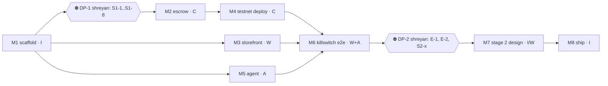

# Work split for First Mate workers

**TL;DR:** Four lanes with separate folders:
- **I, integrator:** root files, `shared/`, docs.
- **C, contracts:** `contracts/**`, in Rust.
- **W, web:** `web/**`.
- **A, agent:** `agent/**`.

Workers run on **agy** (the default; they use shreyan's Google sign-in, so no key is needed). They stop at every ⛔ decision point and ask shreyan. Testnet only, using throwaway faucet accounts.

## How First Mate runs this (firstmate @427056c)
- Start the primary with `cd firstmate && agy`, and talk in plain language ("ahoy", "bearings", "afk"). There is no `/firstmate` command.
- When `config/crew-harness` is unset, workers mirror the primary, so they also run on agy: `agy --prompt-interactive "<brief>" --dangerously-skip-permissions`.
- Each task gets its own worktree on `fm/<task>`. In `direct-PR` mode the worker opens a PR, and shreyan approves each merge (yolo off).
- Workers load `GEMINI.md` → `AGENTS.md` and `.agents/skills/`.

## Lanes
| Lane | Owns | Reads | Milestones |
|---|---|---|---|
| I | `package.json`, `package-lock.json`, `shared/**`, `.github/**`, `docs/**`, `README.md`, `AGENTS.md`, `.env.example`, `LICENSE` | all | M1, M7, M8 |
| C | `contracts/**` | `docs/TECH-SPEC.md` §3, `docs/STILLWORKS-TO-NEAR.md`, `context/stillworks/contracts/`, `context/near/spike-rs/`, skills `near-smart-contracts`, `near-contract-audit`, `near-cli-rs` | M2, M4 |
| W | `web/**` except `web/src/app/api/agent/**` | `shared/**`, skills `near-dapp`, `near-api-js`, `near-intents` (M7) | M3, M6 UI, M7 edge |
| A | `agent/**`, `web/src/app/api/agent/**` | `shared/**`, skills `near-ai-cloud`, `near-api-js` | M5, M6 runner |

Rules:
- Changes to the contract interface: lane C only, and the same PR must update `docs/TECH-SPEC.md` §3.
- `shared/` changes go under "shared/ request" in the PR body.
- Only the integrator commits `package-lock.json` and `Cargo.lock`.

## Rounds

Merge order: C, then W, then A. After each merge, run `cd contracts && cargo test` and `npm install && npm run typecheck` on main.
